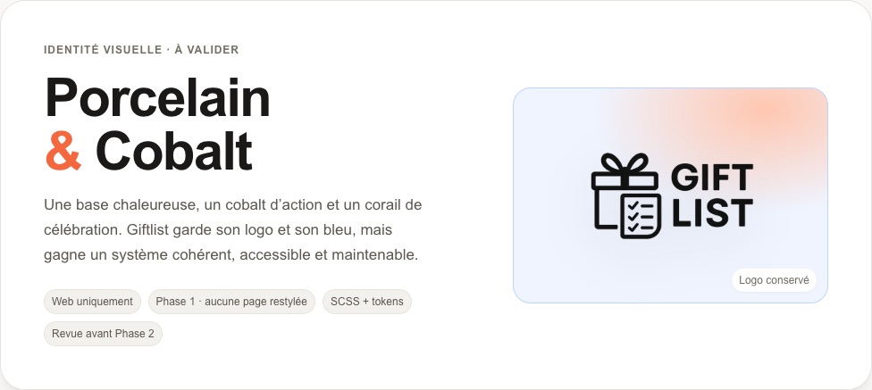
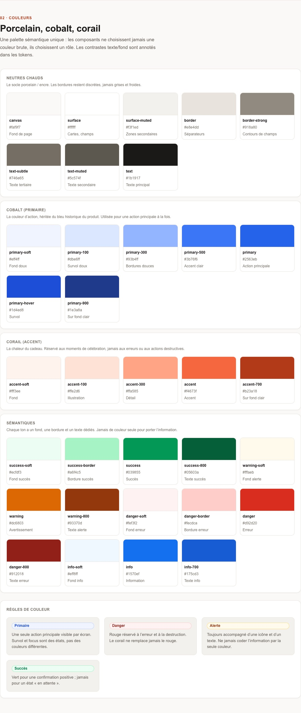
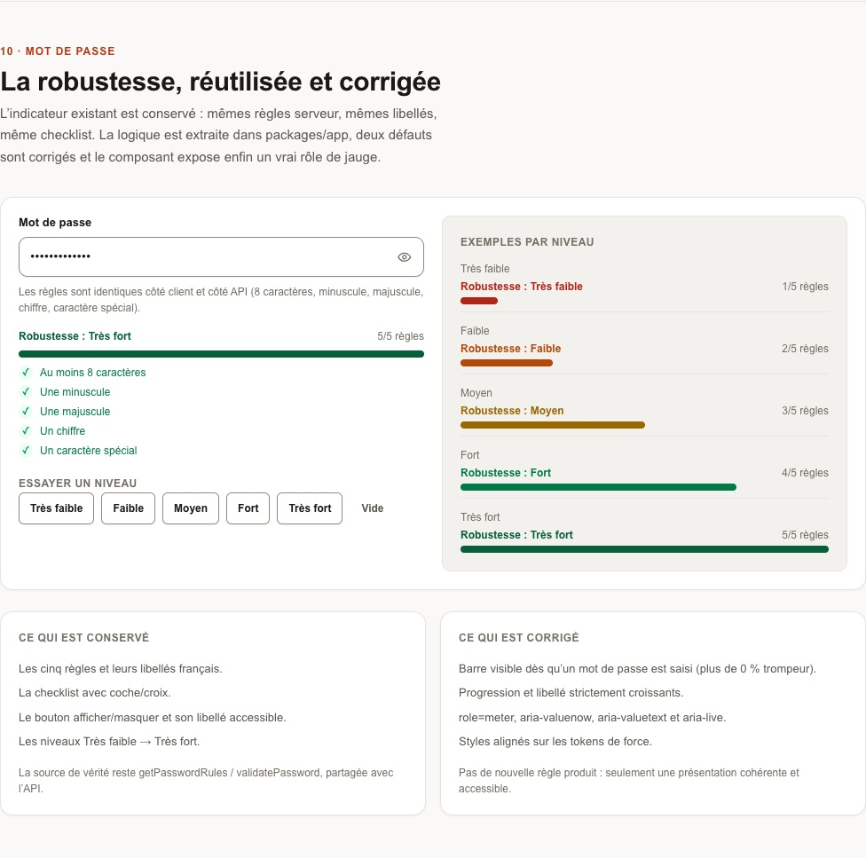

# Giftlist Design System — Phase 1

**Status**: proposal for review. The showcase is the source of truth for the visual identity; application-wide rollout (Phase 2) starts only after explicit approval.

- **Review page**: `/design-system` (local and Vercel preview; `404` on production, `noindex`)
- **Feature artifacts**: [`specs/002-ui-design-system/`](../../specs/002-ui-design-system/spec.md)
- **UI audit (evidence base)**: [ui-audit.md](ui-audit.md)
- **Screenshots**: [Phase 1](screenshots/) · [Phase 2 pages](screenshots/phase-2/) · [Phase 3 UX](screenshots/phase-3/) · [Phase 4 share/perf](screenshots/phase-4/) · [Phase 5 SEO/list UX](screenshots/phase-5/) · [Phase 6 native](screenshots/phase-6/) · [Phase 7 password UX](screenshots/phase-7/)
- **Guardrails**: [`scripts/design-system-guard.sh`](../../scripts/design-system-guard.sh)

## Aperçu







## Direction — “Porcelain & Cobalt”

Giftlist keeps its logo, its cobalt blue and its French voice, but gains a warmer, more confident system:

- **Warm neutrals**: porcelain canvas `#faf9f7`, ink `#1b1917`, sand borders. Less “admin dashboard”, more “paper invitation”.
- **Cobalt primary** `#2563eb`: the same action color as today, formalised as `--ds-color-primary`.
- **Coral accent** `#f4673f`: celebration only (hero, gifting moments, illustrations). Never an error, never a destructive action.
- **Geist Sans / Geist Mono**: already loaded by the app, now actually used instead of Arial.
- **Soft warm shadows**, 10–14 px control/card radii, 4 px spacing rhythm, 44 px touch targets.

Full palette, type scale, spacing, radii and shadows are visible on the showcase, and defined once in [`apps/next/src/styles/_tokens.scss`](../../apps/next/src/styles/_tokens.scss).

## Architecture — Tailwind + Sass, one source of truth

```
apps/next/src/app/globals.css      Tailwind v4 entry (preflight + utilities) + @theme aliases
apps/next/src/styles/index.scss    Sass design-system entry (imported in app/layout.tsx)
├── _tokens.scss                   Sass maps -> :root { --ds-* } (single source of truth)
├── _mixins.scss                   focus-ring, breakpoints, elevation, reduced motion
├── _typography.scss               .ds-display/.ds-h1..4/.ds-body/.ds-label/.ds-mono
├── _buttons.scss                  .ds-btn + variants/sizes/states/loading
├── _forms.scss                    .ds-field/.ds-input/.ds-select/.ds-checkbox/.ds-switch
├── _feedback.scss                 .ds-alert + empty/skeleton
├── _cards.scss                    .ds-card/.ds-badge/.ds-chip/.ds-avatar/.ds-container
├── _strength.scss                 .ds-strength meter
└── _showcase.scss                 review-page layout only (not for product pages)
```

Why two layers:

- Tailwind v4 explicitly does not support CSS preprocessors, and the existing app has 820 Tailwind class usages. Moving `@import "tailwindcss"` into SCSS is unsupported and fragile.
- Sass is first-class in Next.js once `sass` is installed. The design system is therefore authored in SCSS, namespaced `ds-`, and does not change existing pages in Phase 1.
- Tokens are Sass maps that emit CSS custom properties. `globals.css` aliases them into Tailwind (`--color-primary: var(--ds-color-primary)`), so `.ds-*` classes and future `bg-primary` utilities read the same value.
- `@use` only (Dart Sass `@import` is deprecated and removed in 3.0). No `@apply` in SCSS.

## Component contract

The full contract is [`specs/002-ui-design-system/contracts/design-system-classes.md`](../../specs/002-ui-design-system/contracts/design-system-classes.md). Summary:

| Area | Classes |
|------|---------|
| Buttons | `.ds-btn` + `--primary/--secondary/--ghost/--danger/--accent`, `--sm/--md/--lg`, `--block`, `--icon`, `--loading` |
| Forms | `.ds-field`, `.ds-label`, `.ds-input`, `.ds-textarea`, `.ds-select` (dans `.ds-select-wrap`) (+ wrapper `.ds-select-wrap`), `.ds-hint`, `.ds-error`, `.ds-check`, `.ds-switch` |
| Feedback | `.ds-alert` + `--info/--success/--warning/--danger`, `.ds-empty`, `.ds-skeleton` |
| Surfaces | `.ds-card` (+ header/body/footer, `--interactive`), `.ds-badge` (tones + dot), `.ds-chip`, `.ds-avatar`, `.ds-divider` |
| Layout | `.ds-container`, `.ds-section`, `.ds-stack`, `.ds-cluster`, `.ds-grid` |
| Password | `.ds-strength`, `.ds-strength__track/fill/label/rules` |

Rules:

- Use tokens (`var(--ds-*)`) or mixins, never raw hex/px in component partials.
- Component rules live in `@layer components`; Tailwind utilities can still override intentionally.
- Every interactive component shows a visible `:focus-visible` ring (2 px + 2 px offset).
- All controls meet 44 px minimum touch targets; reduced motion disables non-essential animation.
- No colour-only semantics: icon + text for alerts and badges.

## Phase 2 — application-wide harmonization

Phase 2 is implemented on `feat/ui-harmonization`: every web page now uses the shared shell and components.

- **Shell**: web Header (`apps/next/src/components/Header.tsx`, monogram + nav + account + mobile menu), `.ds-page`, `.ds-page__main`, `.ds-page-header`, `.ds-auth`, `.ds-modal`, `.ds-list`, `.ds-table`, `.ds-home`.
- **Auth**: `AuthCard` + shared fields/buttons/alerts; password strength reused from Phase 1.
- **Dashboard / manage / public / profile / admin**: cards, badges, fields, selects, alerts, empty states and dialogs composed from `.ds-*`; the legacy ad-hoc button/input/modal recipes were removed in the refactored files.
- **Select**: `.ds-select` is `appearance: none` with a token-based CSS chevron provided by `.ds-select-wrap`.
- **Modals**: shared `Modal` (role=dialog, aria-modal, labelled title, Escape, focus trap/restore, scroll lock); AlertModal/EditListModal/QR share/Reserve/GiftForm use it.
- **Admin debug tools**: collapsed under “Outils de développement” so the admin page stays visually consistent; behavior is unchanged.
- **Native**: shared `packages/app` Header/home remain the native versions; no CSS is imported into shared/native code.

See [Phase 2 screenshots](screenshots/phase-2/) for every page at desktop and mobile. Public before/after examples are in [before/](screenshots/phase-2/before/) versus the current page captures.

## Phase 3 — UX refinement

The design system was not enough; Phase 3 fixes the experience:

- **Header**: real Giftlist logo on the left, nav grouped left, account action in a compact menu (profile/lists/logout), no separate logout button.
- **Mobile**: no burger duplication — the account menu carries `Mes listes` (nav is hidden), profile and logout; the logo returns home. No app-wide dim/scroll lock.
- **Home**: no black CTA band; a 3-step “Créez / Partagez / Réservez” section and one primary CTA.
- **Action hierarchy**: dashboard list cards use one primary action + overflow menu; manage list edit/delete moved to overflow; delete remains confirmed/danger.
- **Public list**: list-first hero (no logo fallback), compact no-image placeholder.
- **Profile**: logout removed from the sidebar; available from the account menu; dead `/home` link fixed.
- **Footer**: global brand/promise, product links, GitHub source, bug report and copyright; stacks on mobile.
- **Process**: `ui-ux-design` skill + Design Charter in the constitution.

See [Phase 3 screenshots](screenshots/phase-3/).

## Phase 4 — Share branding & list performance

- **README**: centered Giftlist logo at the very top.
- **QR share**: the center is always the Giftlist logo (never the list image), ~23% of the code with error correction H; SVG and downloaded PNG match; decoded successfully with macOS Vision.
- **List opening**: no auth re-check on every client navigation; dashboard “Gérer” is a prefetchable link; public list reuses the auth context.
- **API**: public list fetched in one query with no owner email / reservation email exposure; manage list no longer joins the unused user.

See [Phase 4 screenshots](screenshots/phase-4/).

## Phase 5 — Brand icons, SEO/OpenGraph & list UX

- **Favicon/icons**: cobalt gift/list mark at 16/32/48 (`.ico`), 180 (Apple), 192/512 (PWA); no more full logo as favicon.
- **SEO**: title template + canonical, description, OG/Twitter 1200×630, WebSite/Organization JSON-LD; private routes noindex; robots/sitemap/manifest.
- **Public list**: title before price/status, compact tinted image/placeholder, 3-line description, reserve remains primary.
- **Public lists stay noindex** (share-by-link privacy) but get a list-specific OG preview.

See [Phase 5 screenshots](screenshots/phase-5/).

## Phase 6 — Native app (Expo SDK 57)

- Expo SDK 57 / RN 0.86 / React 19.2, app renamed **Giftlist** with icons and `giftlist` scheme.
- Shared `packages/app/ui` tokens + `Button`, `Card`, `Badge`, `Field`, `Screen`, `AppHeader` with native/web implementations.
- Native flows: auth, dashboard, manage list (add/delete/share), public list + reservation, profile.
- iOS 27.1 simulator runtime installed; release build runs on iPhone 17 Pro; home/login/dashboard/manage/public-list screens verified (see native screenshots).
- EAS project creation still needs `eas login`.

See [Phase 6 native screenshots](screenshots/phase-6/).

## Phase 7 — Password strength & password managers

- Web register: strength track always visible, empty until typing.
- Mobile register: same shared strength component, empty track + rules, confirm password.
- iOS/web credential linking: associated domain `webcredentials:giftlist.fr` + AASA + `textContentType`/autocomplete semantics.

See [Phase 7 screenshots](screenshots/phase-7/).

## Phase 8 — Mobile polish

- Visible “Créer un compte” secondary button.
- Gift thumbnails and edit flow in managed lists.
- Password change in mobile profile/settings.
- Smooth animated strength bar (260 ms).

See [Phase 8 screenshots](screenshots/phase-8/).

## Phase 9 — Real mobile navigation

- Persistent bottom bar: **Mes listes** / **Profil**.
- Main shell cannot stack on itself; details have one back target and hide the bar.
- Centered Giftlist brand header, back on the left, no redundant section title/link.
- Dedicated add/edit gift screen.

See [Phase 9 screenshots](screenshots/phase-9/).

## Phase 19 — Standard list cards & search continuity

- Fixed-width list cards with 16/10 media/placeholder; public and owner grids align.
- Search query preserved in URL; public profile back action.
- Favorites/search separator; mobile upload preview.
- QR center logo theme-aware and enlarged.
- UI skill: `.agents/skills/giftlist-ui/SKILL.md`.

## Phase 18 — Favorite controls, media & settings parity

- `FavoriteButton` icon-only / with-label, light-red favorite token, `aria-pressed`.
- Favorites above search; add/remove directly on public list cards and favorites rows.
- Standard list card with media placeholder; public lists in a responsive grid.
- Mobile personal information form mirrors web.
- Uploaded images via Vercel Blob (5 MB, JPG/PNG/WebP/GIF).

## Phase 17 — Unified identity, shared list cards & favorites

- Owner/public gift cards share one visual contract; owner/public list cards too.
- Favorites are available from a viewed list and shown in search.

- One identity: @username + email; no separate display name in UI.
- Shared ListCard for own lists and public profiles; public cards have no management controls.
- Search/profile list links open directly without a code form.

## Phase 16 — Public search & discoverability

- Third mobile tab **Recherche**; web header link and `/search`.
- Exact list code opens the list (even private); otherwise searches public accounts by unique username.
- Public/private account and list flags with info tooltips; only public lists appear on public profiles.
- Unique lowercase usernames.

See [Phase 16 screenshots](screenshots/phase-16/).

## Phase 15 — Semantic action colours

- Cobalt = one primary action; neutral = support; red = destructive only; coral = celebration.
- Delete is always red + Trash2 + confirmation; never styled as secondary/ghost neutral.
- Showcase includes the action matrix and Modifier/Supprimer pair.

See [Phase 15 screenshots](screenshots/phase-15/).

## Phase 14 — Password visibility & icon system

- Eye/EyeOff toggle on every native and web password field.
- Reusable `Button.icon`, `ShareAction`, `PasswordField` and documented icon charter.
- Clean mobile share pill with Share2.

See [Phase 14 screenshots](screenshots/phase-14/).

## Phase 13 — Email change & branded Resend mail

- Secure email change: current password + signed 30-min confirmation + session rotation.
- Branded transactional emails with logo, CTA and text fallback.
- Opaque light/dark splash variants with rounded brand mark.

See [Phase 13 screenshots](screenshots/phase-13/).

## Phase 12 — Fixed mobile header height

- Header fixed at 60 px; logo stays at the same Y when back/share controls appear.

## Phase 11 — Light / dark / system theme

- Web + mobile: Clair / Sombre / Système, persisted.
- Web header toggle (desktop) + Apparence settings on web/mobile.
- iOS uses SF Symbols; web/Android use Lucide (same icon language as MyOwnNotion).
- Rounded splash/header marks; dark splash; iOS app icon remains system-masked.

See [Phase 11 screenshots](screenshots/phase-11/).

## Phase 10 — Stable mobile header

- Brand header fixed outside scroll; back/share appear without moving the centered logo.
- Detail screens switch instantly (`animation: none`): no slide, no fade.
- Managed-list sharing includes the list URL exactly once.

## Shared-list OpenGraph

- `/list/[shareCode]` now owns a dynamic 1200×630 OG card (title, description, owner, gift count, Giftlist logo), independent of the list’s remote image.
- Metadata points OG/Twitter to `/list/<code>/opengraph-image`; private lists stay `noindex`.
- Generic card fallback if the share code is invalid or the DB is unavailable.

## UX skill

The project ships a reusable `ui-ux-design` skill at [`.agents/skills/ui-ux-design/SKILL.md`](../../.agents/skills/ui-ux-design/SKILL.md) (Claude adapter: `.claude/skills/ui-ux-design`). It covers hierarchy, navigation, action priority, friction, states, accessibility, mobile and the Design Charter. Use it before any UI/UX change; the design system alone is not a UX process.

## Usage in Phase 2

1. Replace page-local Tailwind strings with `.ds-*` components and tokens, starting with the highest-traffic screens (auth, dashboard, public list).
2. Remove duplicated button/input/modal recipes; reuse `.ds-btn`, `.ds-field`, `.ds-card`, `.ds-alert`.
3. Keep only layout utilities from Tailwind initially; if a page needs a new visual value, add a token instead of a raw value.
4. Every refactor PR links its spec and lists the pages/components changed; screenshots before/after are the acceptance evidence.
5. Do not introduce page-specific SCSS in `_showcase.scss`; it exists only for the review page. Page-specific layout can stay in Tailwind utilities, but visual primitives must use `.ds-*`.
6. The select must use `.ds-select-wrap` around `.ds-select`.

## Accessibility baseline

- Focus visible everywhere, keyboard order logical, Escape closes overlays.
- `aria-describedby` + `aria-invalid` on invalid fields; `role="alert"`/`role="status"` on feedback.
- Password strength: `role="meter"`, `aria-valuenow`, `aria-valuetext`, `aria-live` on the label.
- Contrast: body/muted text ≥ 4.5:1, large text ≥ 3:1, control borders ≥ 3:1.
- `prefers-reduced-motion` respects user preference (spinners become static, no shimmer).
- `:focus-visible` is never removed; the global mixin is the only focus style.

## Review and approval gate

1. Open `/design-system` on a Vercel preview (SSO) or locally.
2. Review every section, especially palette, typography, buttons, forms, feedback and password strength.
3. Approve, reject, or list changes in the feature directory. Phase 2 must not start before an explicit decision.

## Local commands

```bash
bun install --frozen-lockfile
bun run web:dev            # http://localhost:3000/design-system
bun run web:typecheck
bun run web:lint
bun run web:build
bun run test
bun run --cwd apps/expo export
./scripts/design-system-guard.sh
```

The showcase does not call the API or the database. `VERCEL_ENV=production` returns `404` for `/design-system`; preview/local renders it.

## Maintenance

- `sass` is a devDependency of `apps/next`; `next.config.ts` exposes `src/styles` via `sassOptions.includePaths`.
- Tokens are the only place to change a colour, radius, shadow or type step. Update the showcase data (`showcase-data.ts`) only for documentation labels/hex, never to override a component.
- The password rules stay in `packages/app/lib/passwordValidation.ts`; scoring is in `packages/app/lib/passwordStrength.ts` and is covered by `apps/next/tests/password-strength.test.ts`.
- Phase 1 deliberately leaves `body { font-family: Arial }` and existing page classes untouched; switching the global body font is a Phase 2 change.
- Updating Spec Kit: see [`docs/spec-kit/README.md`](../spec-kit/README.md) and re-run the Claude skill link sync if needed.
